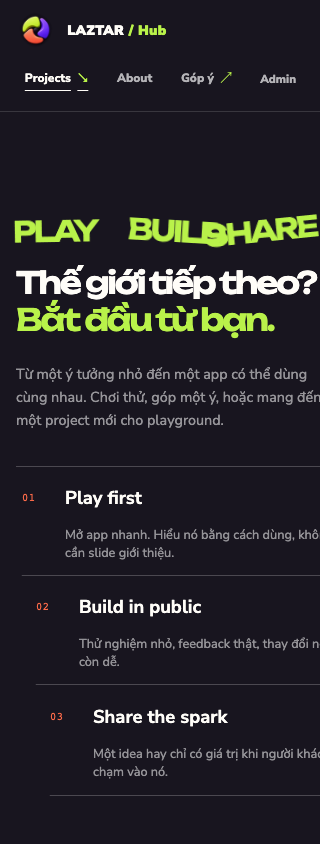
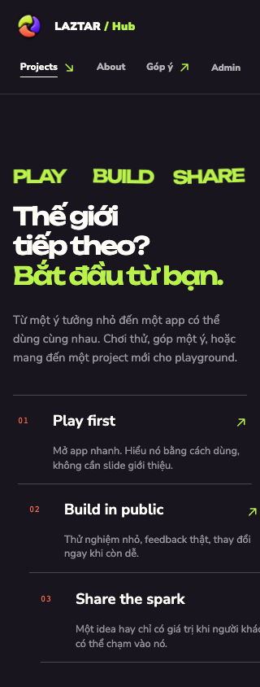

# Mobile polish — Phase 1

Audit ngày 19/10/2026, baseline `c108cb4` trên `main`. Working tree sạch trước khi bắt đầu.
Homepage production khớp baseline qua headings, links và CSS fingerprint `1_znk8gqwjvkd.css`;
không có deployment SHA endpoint để chứng thực toàn bộ build production.

## Lỗi và cách sửa

| Evidence | Root cause | Thay đổi |
| --- | --- | --- |
| BUILD/SHARE chồng khoảng 32px ở 320px, khoảng 61px ở 1440px trong đoạn entrance | Grid min-content rộng hơn container; hai từ chuyển động đối chiều quá xa | `minmax(0, 1fr)`, font mobile vừa container, giảm amplitude nhưng giữ choreography |
| Link tìm hiểu project cao 18px; một số FAQ summary cao 27px | Hit area bằng line box | Minimum hit area 44px cho action links, breadcrumb, brand/footer và FAQ |
| Arrow glyph ngoài dải Unicode của hai webfont | `↗`, `↘`, `↔` phụ thuộc system fallback | SVG Phosphor, `aria-hidden`, không đổi accessible action names |
| GSAP `target not found` trên cả ba trang project | Shared hook tạo tween cho `.chapter-word` chỉ có ở homepage | Chỉ tạo tween khi target tồn tại |
| Hai CTA Sao kê có contrast 4.4912:1 | Chữ vàng `#edce72` trên xanh `#286455` | Riêng chữ CTA đổi sang `#f3db84`, đạt 5.0182:1 |
| Axe yêu cầu kiểm tra ARIA ở bộ lọc | `aria-label` trên generic div | Bổ sung `role="group"` |

## Visual evidence

Chromium 320 × 844, cùng vị trí tương đối của principles section. Before là production;
after là candidate chạy bằng `next start`. Đây là evidence browser emulation, chưa phải thiết bị thật.

| Before | After |
| --- | --- |
|  |  |

Raw screenshots của cả 7 public routes ở 320/375/390/768/1440px, report JSON và video motion 390px
được giữ local ở `docs/visual-qa/phase1/` (ignored). Hai ảnh trên là evidence chọn lọc cho PR,
không nằm trong `public/` hoặc bundle production.

## Verification

- Lint, typecheck, Vitest: pass (9 tests); production build: pass.
- `test:browser`: selector, search/filter, project theater, contrast default/hover/focus,
  keyboard focus Ma Sói, touch targets 320px, reduced motion, missing-target warnings, SVG arrows.
- `test:motion`: 40 route/viewport layouts và 40 scroll sequences ở 5 widths;
  thêm entrance/reversal samples, search remount, back/forward, resize, live reduced-motion change.
- Runtime integration: pass trên SQLite QA riêng, gồm feedback submit, auth/session/protected reads.
- SEO: pass metadata, structured data, robots/sitemap, noindex, redirects và 404.
- Rendered audit: 35 route/viewport combinations; FAQ keyboard, search empty/reset,
  feedback validation/focus, radio touch/keyboard, mid-page refresh và orientation: pass.
- Form states ở 320px: feedback pending/disabled/success và login pending/disabled/error: pass;
  fixture feedback được dọn khỏi database QA sau probe.
- Axe-core 4.14.0, WCAG 2A/2AA/2.1AA: không có violation tự động ở 7 routes × 320/1440px.
  Một số contrast trên artwork/transparency vẫn cần manual judgement (`incomplete`).
- Console/page errors: không có trong matrix 35 trang. Một mẫu page-load/scroll có đo CLS
  0.0095–0.0213 ở candidate và 0.0078–0.0142 ở production; đây là mẫu lab, không phải field Core Web Vitals.
- Independent review: không có finding cần sửa; kiểm tra thêm orbit ở 19 widths 280–1920px.

Không tái hiện hover mất chữ Ma Sói, horizontal overflow, font load failure, motion reverse/resize
hoặc back/forward làm mất scene. Radio feedback đã có label card nhận touch đầy đủ, giữ nguyên.
Không thêm animation, demo controls hoặc đổi thiết kế hero/project chapters.

## Manual QA — chưa chạy

- [ ] Safari iOS và Chrome Android: mở tất cả public routes; kiểm tra text, arrow, focus và CTA.
- [ ] Scroll nhanh/chậm, đảo chiều giữa animation, refresh giữa trang và Back/Forward.
- [ ] Portrait/landscape, browser bars, sticky header và safe areas trên máy có notch.
- [ ] Project selector, tìm/lọc/empty state, app links mở tab mới, FAQ bằng touch.
- [ ] Feedback: chọn loại/project, validation, keyboard/zoom, pending/disabled và success.
- [ ] Login: keyboard/autofill, loading/error; bật Reduce Motion rồi điều hướng lại.
- [ ] Đọc chữ CTA Ma Sói/Sao kê trên default, hover với pointer và focus keyboard.
